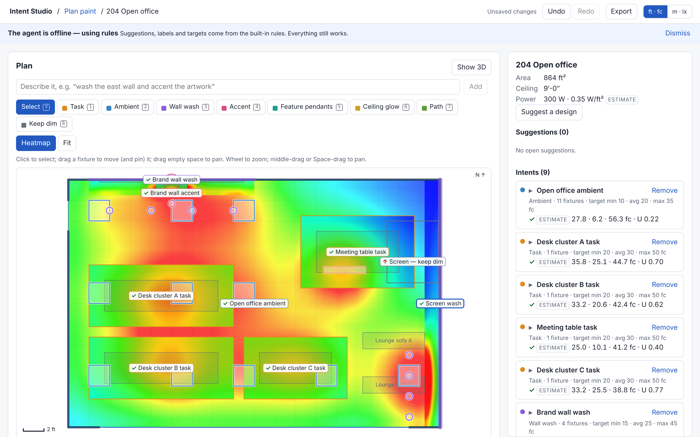
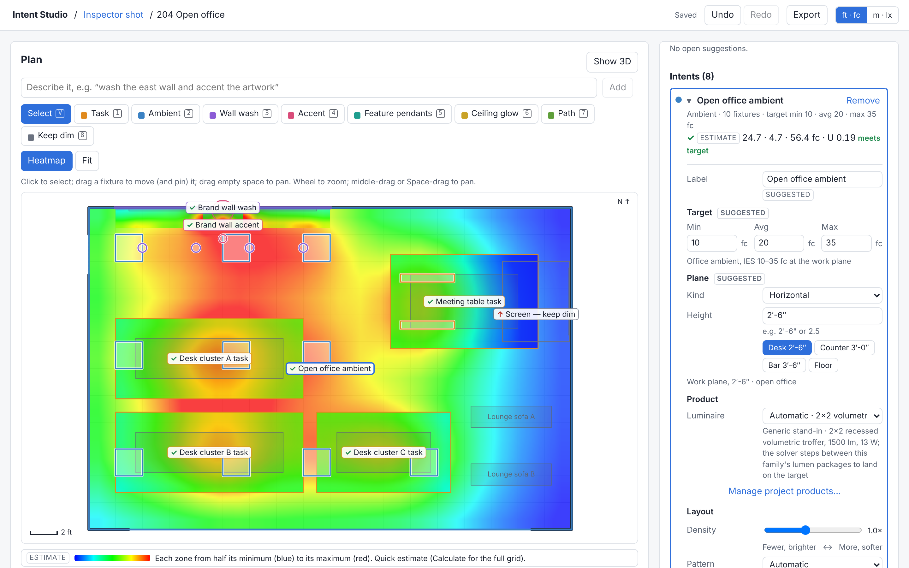

# User guide

All illuminance numbers are **estimates**. The app does not check code compliance.

## Projects and rooms

The home screen lists projects. Open or create one; inside a project you see its rooms and its product library.
A project named "Demo rooms" ships with the Office, Cafeteria, Lobby and Data hall for trying things out.

## Importing a scene and confirming rooms

1. In a project choose to import a scene: GLB, glTF, OBJ or FBX. Pick the source units and up axis if the guess is wrong.
2. The app extracts candidate rooms from the geometry (floor outline, walls, ceiling height, objects) and lists any
   import warnings.
3. **Room confirmation**: each candidate shows its outline. Rename it, fix its kind, untick rooms you do not want,
   and confirm. Objects get a kind (desk, table, shelf, ...); the AI may propose them, you decide. Confirmed rooms are saved.

Large scenes: extraction runs on the full mesh; the display mesh is for context only (toggle "imported mesh context"
in the 3D view).

## Painting intents

An *intent* is "what this area should be like": a region, a plane (floor height, desk height, a wall) and a target.
In the **plan** toolbar:

- **Select** - click to select, drag a fixture to move it, drag empty space to pan, wheel to zoom.
- Paint tools, one per intent kind - area tools: drag a rectangle, or click points and double-click (or Enter) to close
  a polygon; wall tools: click a wall (or a picture/screen on it); point tools: click an object or a point. Esc cancels.
  After a successful paint the tool returns to Select.
- Keys shown on each tool button are shortcuts.

You can also type what you want into **Describe lighting** ("bright task light over the desks, dim the corridor"); the
interpreter (AI, with a rules fallback) turns it into intents.

## Suggestions

**Suggest a design** in the inspector asks for a full proposal (AI when online, otherwise the rules seed). Suggestions
are shown dashed on the plan with a rationale and a source tag (Agent or Rules). Accept or dismiss each one; a new
request replaces only still-open suggestions, never your own intents.

## Inspector

Select an intent to edit it: label, kind, plane height (presets available), target (average / min / max or a range),
pattern, spacing or fixed quantity, product, aim and CCT. Whatever you type is yours: advice and re-suggestions never
overwrite an edited label, target or CCT. CCT marked "suggested" came from the rules or the agent; "set by you" is
yours; choosing Automatic restores the suggestion. The status mark shows whether the estimate meets the target.

## Pinning fixtures

Dragging a fixture in the plan moves it and **pins** it; the intent becomes *hand-tuned* and the solver keeps it as is.
The inspector shows "hand-tuned - N pinned" with **Release hand-tuned**, which unpins all of the intent's fixtures and
lets the solver lay it out again. Undo/redo (Ctrl+Z / Ctrl+Shift+Z) cover every edit.

## 3D view

Views: default (south-east 35 degrees), eye level (5.5 ft), top, face next wall. Toggles: ceiling, imported mesh,
heat textures, lit preview.

## Calculation and ledger

The plan and 3D heat show a quick estimate. **Calculate** runs the full point-by-point calculation in a background
worker (cancellable; progress shown). The **Results (full calculation)** ledger lists every zone with average,
minimum, maximum, uniformity (min/avg), target and status. After you change the design the ledger is marked stale
until you **Recalculate**. The legend always reads "Estimate (point-by-point, simplified inter-reflection)".

## IES library

Each project has its own product library. Upload an `.ies` file (photometric Type C, up to 1 MB); a file that cannot be
used is refused with the parser's reason. Uploaded products appear under "Project products" in the inspector's
product choices and are ranked with the generic packages; "Manage project products..." opens the library from the
inspector. Intensity scales with the fixture's lumens against the file's table lumens.

## Lit preview

The lit-preview toggle in the 3D view lights the room with the layout's fixtures (IES-aware) and an exposure slider.
It is a visual preview, **not a calculation**; read numbers from the ledger.

## Exports

**Export** menu:

| Item | Content |
|---|---|
| Design JSON | Versioned design document (calculation is not included) |
| Fixture schedule CSV | One row per fixture; lengths in the current units |
| Plan PNG | Snapshot of the plan |
| Plan PDF | Plan + schedule, one page |
| glTF (GLB) with lights | Metres, Y-up, `KHR_lights_punctual` |

## Units

The header switches Imperial (default) and Metric. Inside, everything is feet and footcandles; conversion happens
only for display and exports (the GLB is always metres).
