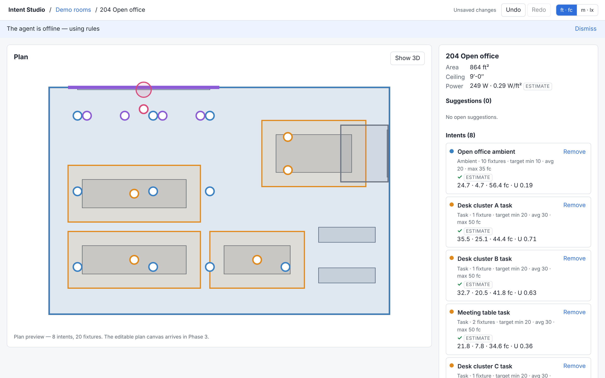
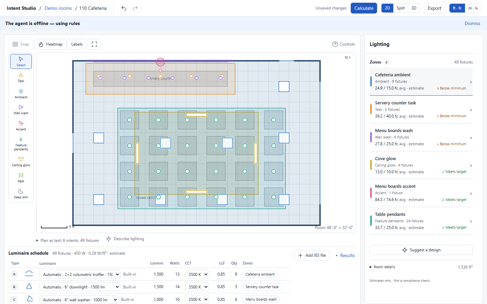
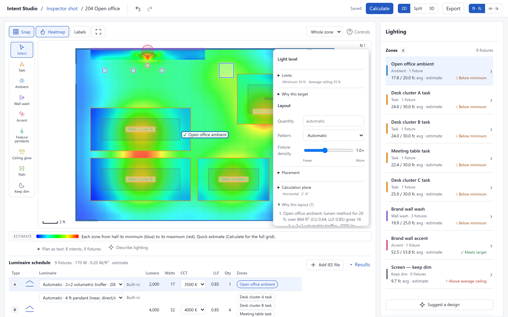
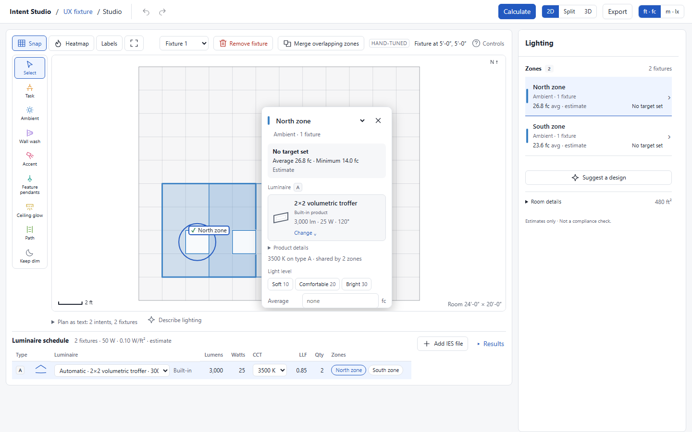
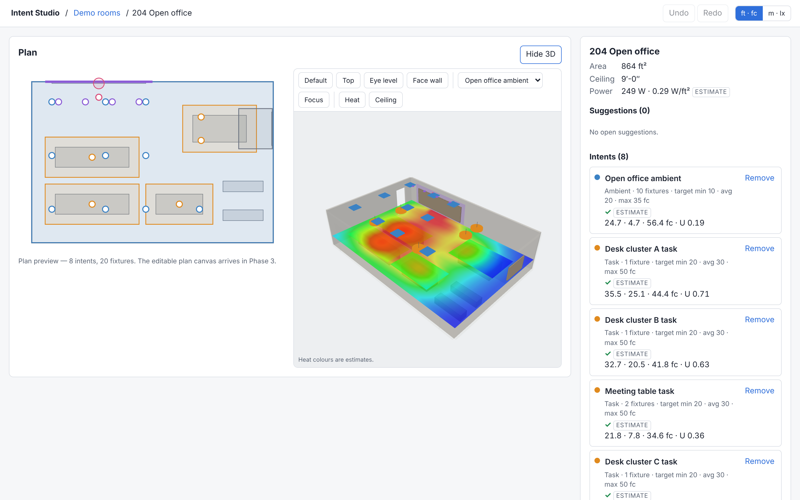
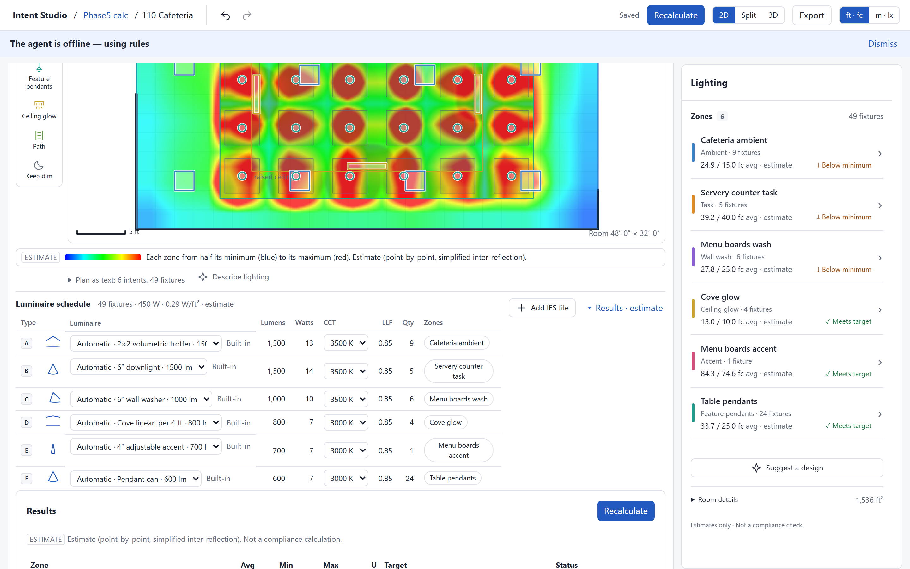
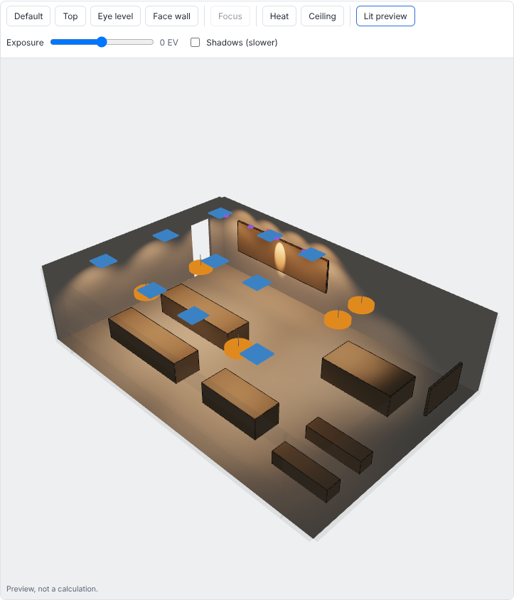

# User guide

All illuminance numbers are **estimates**. The app does not check code compliance.

## Projects and rooms

The home screen lists projects. Open or create one; inside a project you see its rooms and its product library.
A project named "Demo rooms" ships with the Office, Cafeteria, Lobby and Data hall for trying things out.

## Importing a scene and confirming rooms

1. In a project choose to import a scene: GLB, glTF, OBJ or FBX. Pick the source units and up axis if the guess is wrong.
2. The app extracts candidate rooms from the geometry (floor outline, walls, ceiling height, objects) and lists any
   import warnings.
3. **Room confirmation**: each candidate shows its outline. Rename it, fix its kind, untick rooms you do not want,
   and confirm. Objects get a kind (desk, table, shelf, ...); the AI may propose them, you decide. Confirmed rooms are saved.

Large scenes: extraction runs on the full mesh; the display mesh is for context only (toggle "imported mesh context"
in the 3D view).

## Painting intents

An *intent* is "what this area should be like": a region, a plane (floor height, desk height, a wall) and a target.
In the **plan** toolbar:

- **Select** - click to select, drag a fixture to move it, drag empty space to pan, wheel to zoom.
- Paint tools, one per intent kind - area tools: drag a rectangle, or click points and double-click (or Enter) to close
  a polygon; wall tools: click a wall (or a picture/screen on it); point tools: click an object or a point. Esc cancels.
  After a successful paint the tool returns to Select.
- Hover a tool to see its shortcut. **V** selects; **1–8** choose lighting tools.
- **Labels** shows every zone name; with it off, only the selected zone is labelled.
- **Controls** opens navigation help.

Expand **Describe lighting** below the plan to type what you want ("bright task light over the desks, dim the corridor"); the
interpreter (AI, with a rules fallback) turns it into intents.

## Suggestions

**Suggest a design** in the inspector asks for a full proposal (AI when online, otherwise the rules seed). Suggestions
are shown dashed on the plan with a rationale and a source tag (Agent or Rules). Accept or dismiss each one; a new
request replaces only still-open suggestions, never your own intents.

## Inspector

The right panel starts with a compact list of lighting zones. Select a zone to open its settings; use the zone selector at the top to switch directly, or **Zones** to return to the overview. The navigator stays visible while you scroll.

The zone name is editable at the top. Click the product card or **Change** to choose an uploaded IES or built-in product; the card shows its name, source, lumen output, watts and beam angle. Color temperature stays beside the product. **Import IES** opens the project library.

**Light level** shows the average target. Expand **Limits** for a minimum at any point and a ceiling on the average. The estimate labels Average, Minimum and Maximum separately; a high point maximum does not fail the average ceiling. Feedback checks the model's minimum and average tolerances, and an empty target says **No target set**.

**Layout** keeps quantity, pattern and fixture density together. **Placement** opens mounting/aim controls; **Calculation plane** opens plane type, height and presets. Advice never replaces an edited name, target or color temperature. **Why this target** and **Why this layout** retain the explanations without filling the primary editor.

## Pinning fixtures

Dragging a fixture in the plan moves it and **pins** it; the intent becomes *hand-tuned* and the solver keeps it as is.
The inspector shows **Manual layout** with **Regenerate layout**, which unpins all of the intent's fixtures and
lets the solver lay it out again. Undo/redo (Ctrl+Z / Ctrl+Shift+Z) cover every edit.

## Removing fixtures, merging zones and snapping

- Select a fixture on the plan (or choose it in **Selected fixture**) and choose **Remove fixture**. With the canvas focused, **Delete** and **Backspace** also remove just that fixture. The zone stays in place, including when its last fixture is removed. Undo restores the fixture; redo removes it again. Manual deletions persist across saves and reloads. **Regenerate layout** intentionally regenerates the zone, so deleted fixtures may return.
- Select an area zone and choose **Merge overlapping zones** when available. Review the outline and included zone names, then choose **Merge zones**. Only accepted, overlapping zones with matching type, product, target, workplane, layout settings and attachments can merge. The selected zone keeps its name and settings, duplicate fixture positions are removed, and the layout becomes hand-tuned. Undo restores both zones. Disconnected outlines and outlines with holes cannot merge.
- **Snap** above the canvas toggles ceiling-grid alignment for the selected zone. Ceiling-mounted fixtures preview their snapped position and crosshair while dragging. Turn it off for free placement. The control is disabled if no ceiling grid is available or no accepted zone is selected. Snapping respects rotated grids and does not move a fixture outside its zone or into a ceiling pocket.

## 3D view

Views: default (south-east 35 degrees), eye level (5.5 ft), top, face next wall. Toggles: ceiling, imported mesh,
heat textures, lit preview.

## Calculation and ledger

The plan and 3D heat show a quick estimate. **Calculate** runs the full point-by-point calculation in a background
worker (cancellable; progress shown). The **Results** ledger (collapsed until needed) lists every zone with average,
minimum, maximum, uniformity (min/avg), target and status. After you change the design the ledger is marked stale
until you **Recalculate**. The legend always reads "Estimate (point-by-point, simplified inter-reflection)".

## IES library

Each project has its own product library. Upload an `.ies` file (photometric Type C, up to 1 MB); a file that cannot be
used is refused with the parser's reason. Uploaded products appear under "Project products" in the inspector's
product choices alongside built-in packages. **Products** in the zone overview opens the library without a selection; **Import IES** opens it while editing a zone. The product preview shows its source, lumen output, watts and beam angle. Intensity scales with the fixture's lumens against the file's table lumens.

## Lit preview

The lit-preview toggle in the 3D view lights the room with the layout's fixtures (IES-aware) and an exposure slider.
It is a visual preview, **not a calculation**; read numbers from the ledger.

## Exports

**Export** menu:

| Item | Content |
|---|---|
| Design JSON | Versioned design document (calculation is not included) |
| Fixture schedule CSV | One row per fixture; lengths in the current units |
| Plan PNG | Snapshot of the plan |
| Plan PDF | Plan + schedule, one page |
| glTF (GLB) with lights | Metres, Y-up, `KHR_lights_punctual` |

## Units

The header switches Imperial (default) and Metric. Inside, everything is feet and footcandles; conversion happens
only for display and exports (the GLB is always metres).
